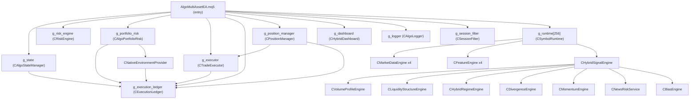

# AlgoMultiAssetEA — System Integration Audit & Implementation Roadmap

Status: DRAFT — read-only audit, no source changes made.
Generated: 2026-11-12
Tool-call note: earlier failed write/edit invocations were schema violations (missing required args); all file writes since have used the correct 2-arg write schema and were verified by read-back.

---

## 1. Executive Summary

The AlgoMultiAssetEA is a single-chart MultiTrader EA (one `Experts/AlgoMultiAssetEA.mq5`, 3948 lines, 29 effective headers) that discovers up to ~80 forex symbols, builds four independent timeframe roles per symbol (Context H4, Structure H1, Setup H1, Entry M15 for DAY style), runs a `CHybridSignalEngine` decision per symbol on each new entry-bar tick, and routes candidate decisions through RiskEngine → PortfolioRisk → durable ExecutionLedger claim+intent → TradeExecutor → broker. A coordinator election (SQLite-backed authority) grants one chart the right to submit; other charts run chart-context-only.

**Verified state (static only; no compile/test/runtime was executed):**
- The signal pipeline is real and traceable end-to-end. `CHybridSignalEngine::Evaluate()` is genuinely called from `ProcessRuntime()` for every valid runtime on every tick while coordinator.
- The dashboard IS fed from two disjoint paths: `g_dashboard.Update(decision,...)` in the decision path (per tick) and `UpdateDashboardForChart()` → `SetRuntimeSnapshot` + `RenderMarketView` only from `OnTimer` (5 s) and end of init. **`OnTick` never calls `UpdateDashboardForChart()`**, so the market view (BID/ASK, SPREAD, BAR) refreshes at most every 5 s, and only for `ChartSymbol(0)`.
- `CSignalEngine` (the legacy signal-arbitration class) is **dead code**: the header `SignalEngine.mqh` is never `#include`d by any file in the project, and no `CSignalEngine` instance exists. All signal arbitration is done inside `CHybridSignalEngine::Evaluate()`. This is a P2 dead-code/orphan finding, NOT a signal-loss cause.
- Five strategy classes (`Trend/Breakout/Momentum/MeanReversion/RelativeValue`), `CRegimeEngine`, `CAlgoDashboard`, `CRobustnessEngine`, `CWalkForwardValidator` are **orphan headers** — never included, never instantiated.
- Two genuine **initialization-order defects** are confirmed: (a) `g_executor.ConfigureAuthority(...)` runs at EA:2084 *before* `g_execution_ledger.Initialize()` at EA:2096; (b) `g_state.Initialize()` (which calls `Reconstruct()`) runs at EA:2040 *before* `g_state.SetExecutionLedger(...)` at EA:2146, so the first position-ownership reconstruction runs with `m_execution_ledger == NULL` and falls into the fail-closed "reject attempt_magic range" branch.
- `g_optimizer` (EA:757) is constructed but **never initialized or called** — dead object.
- `CFeatureEngine` indicator handles are never released in `OnDeinit` (no `ReleaseAllHandles` call anywhere in the EA or `CFeatureEngine`).

**Most likely explanation for "EA produces no usable signal / dashboard wrong":** not a broken architecture, but (1) coordinator election failing silently (ledger unavailable / authority orphaned → `COORD_MODE_UNAVAILABLE` → `OnTick`/`OnTimer` both skip `ProcessRuntime` entirely, so no signal and no dashboard decision updates), and (2) the dashboard market view being on a 5 s timer path rather than the tick path. Both are wiring/observability defects, not architecture redesign.

---

## 2. Repository Baseline

- Branch: `main`
- HEAD: `a0d9eae413db1f719c52cea1c3746028dd9227e8` — `feat(kilo): unify project engineering workflow (#2)`
- Working tree: 10 modified files, 0 untracked, 0 staged.
- Modified files (all pre-existing user changes, **preserved, not touched**):
  - `Experts/AlgoMultiAssetEA.mq5`
  - `Include/AlgoSystem/ExecutionLedger.mqh`
  - `Include/AlgoSystem/MarketData.mqh`
  - `Include/AlgoSystem/NewsRiskService.mqh`
  - `Include/AlgoSystem/PortfolioRisk.mqh`
  - `Include/AlgoSystem/PositionManager.mqh`
  - `Include/AlgoSystem/StateManager.mqh`
  - `tools/AlgoMultiAssetEA-ValidationHarness.ps1`
  - `tools/Compile-MT5.ps1`
  - `tools/ValidationHarness.Tests.ps1`
- Project structure: `Experts/` (1 mq5), `Include/AlgoSystem/` (39 mqh), `tools/` (3 ps1). No `docs/` existed before this audit; this is the first documentation file.
- No `.kilo/` command/agent directory exists in the repo; only AGENTS.md and `.kilo/rules/*.md` are present in the terminal data folder.
- Tools present: `tools/Compile-MT5.ps1`, `tools/AlgoMultiAssetEA-ValidationHarness.ps1`, `tools/ValidationHarness.Tests.ps1`.
- **Limitation:** No compile, test, or runtime validation was performed in this audit (read-only mission). All findings below are `STATIC_VERIFIED`.

---

## 3. System Architecture Inventory

### 3.1 Components

| Component | Class | File | Instantiation | Role |
|---|---|---|---|---|
| Runtime per symbol | `CSymbolRuntime` | EA:490 | `g_runtime[256]` EA:702 | Holds 4 market engines, 4 feature engines, 1 hybrid engine, snapshot |
| Market data | `CMarketDataEngine` | MarketData.mqh:23 | 4 per runtime EA:500-503 | Tick + closed bar + symbol properties |
| Features | `CFeatureEngine` | Indicators.mqh:21 | 4 per runtime EA:505-508 | EMA/ADX/ATR/RSI/MACD/ROC handles |
| Hybrid decision | `CHybridSignalEngine` | HybridEngine.mqh:27 | 1 per runtime EA:510 | Regime+liquidity+profile+bias+momentum+divergence+news → TradePlan |
| Sub-engines | CVolumeProfileEngine, CLiquidityStructureEngine, CHybridRegimeEngine, CDivergenceEngine, CMomentumEngine, CNewsRiskService, CBiasEngine | respective mqh | members of HybridEngine | Feature calculators |
| Risk | `CRiskEngine` | RiskEngine.mqh:21 | `g_risk_engine` EA:748 | Volume sizing, stops, margin |
| Portfolio | `CAlgoPortfolioRisk` | PortfolioRisk.mqh:9 | `g_portfolio_risk` EA:749 | Exposure, limits, admission, reservations |
| Execution | `CTradeExecutor` | TradeExecutor.mqh:23 | `g_executor` EA:750 | Sole broker-call boundary |
| Ledger | `CExecutionLedger` | ExecutionLedger.mqh:128 | `g_execution_ledger` EA:751 | SQLite durable claims/attempts/authority |
| Positions | `CPositionManager` | PositionManager.mqh:23 | `g_position_manager` EA:752 | BE/trailing/time-exit |
| State | `CAlgoStateManager` | StateManager.mqh:7 | `g_state` EA:747 | Daily/monthly PnL, locks, position counts |
| Dashboard | `CHybridDashboard` | HybridDashboard.mqh:6 | `g_dashboard` EA:754 | Chart objects, labels |
| Logger | `CAlgoLogger` | Logger.mqh:7 | `g_logger` EA:753 | File/console event log |
| Session | `CSessionFilter` | SessionFilter.mqh:4 | `g_session_filter` EA:755 | Session hours gate |
| Tester | `CTesterFitness` | TesterFitness.mqh:18 | `g_tester_fitness` EA:756 | OnTester criterion |
| Optimizer | `COptimizationController` | Optimization.mqh:45 | `g_optimizer` EA:757 | **never called** |

### 3.2 Orphan / dead headers (never included, never instantiated)

`SignalEngine.mqh`, `RegimeEngine.mqh`, `Dashboard.mqh`, `Robustness.mqh`, `WalkForward.mqh`, `TrendStrategy.mqh`, `BreakoutStrategy.mqh`, `MomentumStrategy.mqh`, `MeanReversionStrategy.mqh`, `RelativeValueStrategy.mqh`.

### 3.3 Include graph (DAG, no cycles)

EA includes 21 headers directly. Effective transitive closure = 29 headers. Key edges: `HybridEngine.mqh` → {HybridTypes, VolumeProfile, LiquidityEngine, HybridRegime, DivergenceEngine, MomentumEngine, NewsRiskService, BiasEngine, Utilities, Trade/SymbolInfo}; `PortfolioRisk.mqh` → {Interfaces, ExecutionLedger, EnvironmentProvider, Trade/Trade}; `TradeExecutor.mqh` → {Trade/Trade, Interfaces, Utilities, ExecutionLedger}; `PositionManager.mqh` → {Interfaces, TradeExecutor, ExecutionLedger}; `StateManager.mqh` → {Interfaces, ExecutionLedger}; `MarketData.mqh` → {Interfaces}; `Indicators.mqh` → {Interfaces}.

---

## 4. Dependency Graph

**Initialization order (EA:2035-2242, VERIFIED):**
1. `g_session_filter.Set` (2035)
2. `g_state.Initialize()` → `Reconstruct()` (2040) — **ledger still NULL**
3. `g_state.ApplyLocks` (2048)
4. `g_risk_engine.SetParameters` (2053) → `Initialize` (2058)
5. `g_portfolio_risk.SetParameters` (2065) → `Initialize` (2074)
6. `g_executor.SetDeviationPoints` (2081) → `ConfigureAuthority(&g_execution_ledger)` (2084) → `SyncAuthority` (2087) → `Initialize` (2089)
7. `g_execution_ledger.Initialize("...sqlite")` (2096)
8. ledger recovery/inspection (2114-2140)
9. `g_position_manager.SetExecutionLedger` (2144); `g_portfolio_risk.SetExecutionLedger` (2145); `g_state.SetExecutionLedger` (2146)
10. `g_position_manager.SetExecutor(&g_executor)` (2163) → `Initialize` (2165)
11. Coordinator election (2174-2207); if coordinator → `InitializePendingRuntimes()` (2192)
12. `g_state.Reconstruct()` (2209) — **now with ledger attached**
13. `g_system_ready = true` (2224)

---