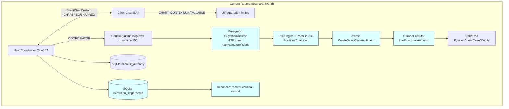
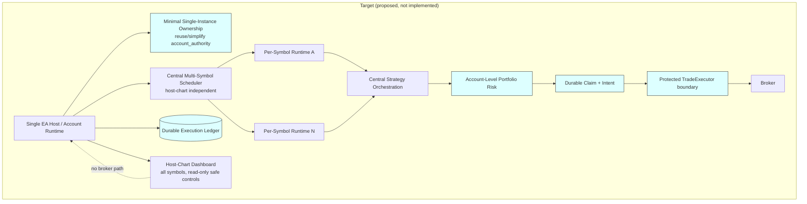
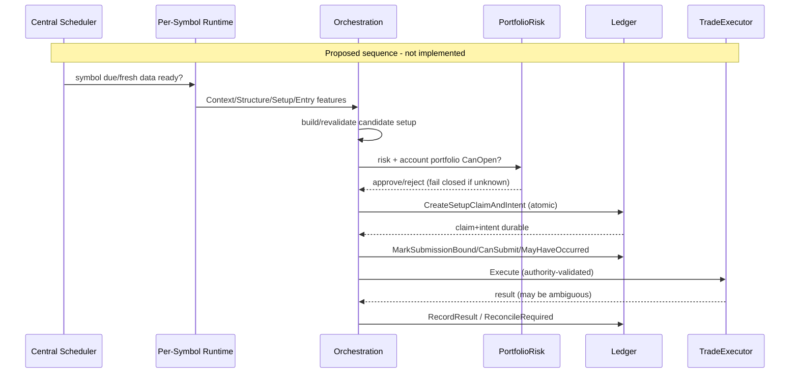
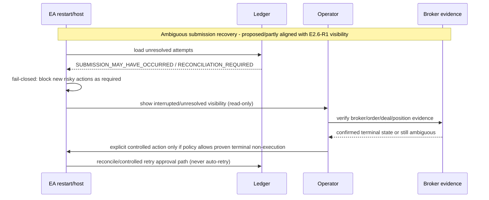
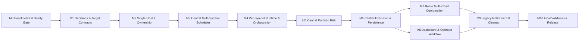

# AlgoMultiAssetEA — Single-EA / Multi-Symbol / Single-Account Architecture Roadmap

**Status:** `ROADMAP_READY_FOR_HUMAN_APPROVAL` (documentation only; target architecture **not implemented**; reviewer citation/clarity fixes applied to this doc)  
**Date:** 2026-11-07 (source inspection date in workspace context)  
**Scope:** Read-only architecture investigation and migration roadmap. **No `.mq5`/`.mqh` source files, Kilo config, DB, or Git state were changed.**

---

## 1. Executive architecture decision summary

**Preferred target (human intent):** one Expert Advisor instance → multiple managed trading symbols → one MT5 terminal → one trading account. The host chart is a presentation/hosting context, not the trading symbol universe.

**Current reality (VERIFIED from source):** the EA already contains a **central multi-symbol runtime array** (`g_runtime[256]`, `CSymbolRuntime`, 4 timeframe roles × market/feature engines per runtime; `Experts/AlgoMultiAssetEA.mq5:490-510,702`) and processes runtimes centrally when `g_coordinator_mode==COORD_MODE_COORDINATOR` (`OnTick:2210-2232`, `OnTimer:2369-2385`). However, it also contains a **multi-chart coordination model** (Coordinator/Chart Context, chart registration/discovery/subscribers, EventChartCustom protocol, snapshot transport, authority election/heartbeat, retry UI tied to chart objects). Execution is denied unless `COORDINATOR` and authority validates (`ProcessHybridDecision:1209+`, `TradeExecutor` authority gate). This means the codebase is **not yet** the target “simple single instance without distributed chart coordination”; it is a hybrid: multi-symbol analysis core plus multi-instance/chart coordination and a shared SQLite ledger.

**Migration principle:** simplify toward one owner/one scheduler/one account risk/one protected execution boundary/one durable ledger, while **retaining safety infrastructure** (TradeExecutor boundary, durable intent/attempt/claim, atomic ledger ops, authority validation, reconciliation, no auto-retry). Do **not** remove Coordinator/Authority/EventChartCustom/SQLite schema until replacement controls and dependencies are proven. E2.6 remains a safety gate with open human decisions and missing validation evidence.

---

## 2. Current-state architecture map (source evidence)

Evidence labels: `VERIFIED` = observed in current source; `INFERRED` = logical from source; `UNKNOWN/UNVERIFIED` = not provable statically.

### A. EA lifecycle and orchestration
| Area | Evidence | Notes |
|---|---|---|
| Initialization | `OnInit():2107`; config/group fingerprint `2129-2130`; `EventSetTimer(5):2169`; `InitializeSystemWhenReady():2178/1866` | Ledger init, runtime init, authority/election attempted. |
| Tick processing | `OnTick():2210` refreshes state, updates positions, processes runtimes **only if** `COORD_MODE_COORDINATOR:2224` | Chart tick drives loop; managed symbols are iterated from runtime array, but **MQL5 `OnTick` is chart-symbol tick** (platform constraint — requires official confirmation in validation). `UNKNOWN` whether all managed symbols receive timely data without independent scheduling. |
| Timer processing | `OnTimer():2234` discovery/registration/snapshot/heartbeat/reconcile/retry handoff/claim diag/`ProcessRuntime` for coordinator `2378+` | Central periodic work exists. |
| Broker events | `OnTradeTransaction():2397` filters managed magics, `ReconcileUnresolved(10)` | Complement to timer reconciliation (per prior E2.6 design). |
| Chart events | `OnChartEvent():3251`; custom handlers `CHARTREG_DISCOVERY/REGISTER/ACK/UNREGISTER/SNAPREG_NOTIFY/ACK` `3268,3305,3374,3404,3427,3452` | Protocol and retry UI routing. |
| Symbol universe | `DiscoverForexSymbols` via `InitializePendingRuntimes:1673`; optional metals/crypto inputs; tester uses `_Symbol` `1711`; runtimes fixed array `g_runtime[256]:702` | Ownership is input/discovery-driven, **not** host chart symbol for the runtime list — but host chart has UI/log dependencies (below). |
| Host chart dependency | `UpdateDashboardForChart` uses `ChartSymbol(0):771`; `ShowRuntimeGateStatus` only when `runtime.symbol==ChartSymbol(0):830`; retry UI chart context checks `ChartID/ChartSymbol(0):2599,2617`; many logs use `_Symbol` (e.g. `1963,1975,3490`) | **VERIFIED dependency exists** (UI/diagnostic/chart object ownership). Target must explicitly decide host-chart-independence for analysis vs UI. |
| Duplicate scheduling/ownership | Coordinator mode gates runtime processing and execution authorization (`1209,1224,2224,2378`); authority heartbeat/validate `2312-2313` | Multi-instance protection exists but is coupled to multi-chart coordination model. |

### B. Symbol and strategy runtime
| Area | Evidence | Notes |
|---|---|---|
| Per-symbol runtime | `CSymbolRuntime:490` holds `symbol`, 4 TFs, 4 market engines, 4 feature engines, `CHybridSignalEngine hybrid_engine`, gate status | **VERIFIED per-runtime isolation container** (one per configured symbol/runtime slot). |
| TF roles | `SelectStyleTimeframes:170` (scalping M15/M5/M5/M1; day H4/H1/H1/M15; swing D1/H4/H4/H1) | Verify against approved decision records before migration changes; do not infer unapproved mappings. |
| Freshness | `ResolveFreshnessForSymbol:205` with fail-closed parsing; `IsSetupFresh` checked `980+`; role-specific freshness inputs exist in EA config | Data-freshness ownership appears per runtime/symbol context — `UNVERIFIED` for all edge paths. |
| Setup identity | `setup_id`, restart-stable `logical_setup_key`, stable `canonical_identity` (v2) used in execution path (`928,1160-1171`); `ExecutionLedger` identity helpers | Preserve independence of Setup ID / Attempt ID / broker tickets. |
| Duplicate prevention | volatile consumed checks + durable `CreateSetupClaimAndIntent` atomic before intent/broker (`EA:1139-1210`, call `1170`; `Ledger` decl `:161`, def `:2791+`) | Durable claim is the restart-safe gate; volatile suppression is not sufficient alone. |

### C. Chart and Coordinator infrastructure
| Component | Evidence | Current role | Migration implication |
|---|---|---|---|
| Coordinator election / modes | `COORD_MODE_*:712-713`; set in `InitializeSystemWhenReady` around authority acquire/failure (`2015-2040`); checked widely (`1209,2224,2255,2378,2627`) | Only coordinator processes runtimes/executes; chart context limited to UI/registration | Retiring this **without** a replacement single-instance guard breaks authorization and may allow duplicate processing. |
| Account authority | `account_authority` in ledger (`E2.4` APIs `296-310`, DB lifecycle); `ValidateAuthority/Heartbeat/Acquire/Release` used in EA/Executor | Shared ownership/epoch/token guard, fail-closed | Candidate minimal single-instance guard if simplified; must not become bypass. |
| Registration/discovery/subscribers | `CHARTREG_*` events `704-707,3268-3390`; subscriber array `g_subscribers[64]:736`; snapshot transport `SNAPREG_*:709-710,3404-3452` | Multi-chart dashboard/snapshot/routing | Target single dashboard/host chart may remove need, but only after dependency proof. |
| EventChartCustom protocol | Producers/consumers in `OnChartEvent/OnDeinit` (best-effort UNREG `3375-3390`), `OnTimer` snapshot | Local-terminal coordination; recent fixes aligned UNREGISTER contract; SNAPREG_ACK read-only handler added (E2.6-R1 context) | Trust model local-terminal A vs untrusted local B is **human decision**; protocol retirement possible only when unused. |
| Retry UI/handoff | Chart objects `AlgoE2E6Retry_*`, `OnChartEvent` object click routing, transient `RetryPendingHandoff`, timer-only `ProcessRetryPendingHandoff:2354,3050+`, durable approval events/Inspect read-only (R1) | Operator approval/review on chart; transient handoff not auto-restored | UI can remain chart-hosted in target, but must not require multi-chart coordination. |

### D. Risk and portfolio management
| Area | Evidence | Assessment |
|---|---|---|
| Trade risk | `CRiskEngine` configured in init (`1913`); evaluated in `ProcessHybridDecision` (`1039+`) | Keep as gate; signal ≠ authorization. |
| Portfolio risk | `CAlgoPortfolioRisk g_portfolio_risk:747`; params `1906`; `CanOpen` `1070`; scans `PositionsTotal()/PositionGetTicket/PositionGet*` and managed magics (`PortfolioRisk.mqh:20-220+`); rejects on invalid open position risk `199-204` | **VERIFIED account/terminal broker position scan within process** (uses MT5 position APIs). In single-process single-EA target this is naturally account-level for that terminal. **INFERRED risk:** if old multi-instance mode allowed multiple coordinators/process assumptions, portfolio checks could diverge; also simultaneous candidate arbitration/reservation not evidenced here — `UNKNOWN`. |
| Exposure types | Counts per total/symbol/strategy, portfolio/precious risk percent, invalid existing position risk => reject | Claims limited to evidenced checks; no correlation/margin-reservation guarantees beyond code. |

### E. Execution and persistence (safety infrastructure — retain/simplify carefully)
| Component | Evidence | Safety role |
|---|---|---|
| `TradeExecutor` | `CTradeExecutor g_executor:748`; sole broker mutation boundary `TradeExecutor.mqh:10-14,830 PositionOpen,924 Close,978 Modify`; `Execute` validates + `HasExecutionAuthority` `744-786,33-45` | **KEEP** as single protected boundary. |
| `ExecutionLedger` | `CExecutionLedger g_execution_ledger:749`; SQLite `execution_ledger.sqlite` (`ExecutionLedger.mqh:110,377 DatabaseOpen READWRITE|CREATE`); schema/attempts/claims/authority/retry approval events, tx helpers | **KEEP** durable intent/reconciliation/audit. |
| Atomic claim+intent | `CreateSetupClaimAndIntent` one tx (`Ledger` decl `:161`, def `:2791+`); EA uses it before intent/broker (`EA:1139-1210`) | **KEEP** (RS-01 hardening). |
| Submission protocol | `MarkSubmissionBound -> CanSubmit -> MarkSubmissionMayHaveOccurred -> executor.Execute -> RecordResult/Reconcile` (`EA:1243-1365`) | **KEEP** fail-closed ambiguous handling. |
| Authority | ledger authority APIs; executor sync/validate; EA coordinator/authority checks | Minimal ownership guard candidate; F-E26-005 position-management policy unresolved. |
| SQLite ownership/concurrency | DB opened by filename in terminal data context (`DatabaseOpen` file name); shared file if multiple instances use same terminal/path | **UNVERIFIED runtime** for multi-instance concurrency/locking/crash behavior. Target single-instance reduces contention but does not prove DB durability semantics. |

### F. Dashboard and UI
| Area | Evidence | Notes |
|---|---|---|
| Dashboard | `CHybridDashboard g_dashboard:752`; `UpdateDashboardForChart:765` filters by `ChartSymbol(0)` | Chart-hosted, chart-symbol-filtered view. Target needs single central view of all managed symbols without per-symbol chart EAs. |
| Retry UI | `AlgoE2E6Retry_*` objects, inspect/review/confirm/cancel, read-only interrupted visibility (R1) | Keep safe manual controls; do not add auto-retry. |
| Chart objects | Created/deleted by EA (`RetryUIClear:2578`, snapshot `AlgoEA_Dashboard` label `2296`) | Ownership/lifecycle remains chart-local concern in target host UI. |

*Diagram represents current source-observed behavior, not target implementation.*

---

## 3. Target-state architecture and responsibilities

Logical roles (not mandatory new classes/files). Reuse existing components where evidence supports.

| Role | Responsibility | Reuse/simplify |
|---|---|---|
| **Single EA Host / Account Runtime** | Init/shutdown, account/terminal context, symbol universe, scheduler, orchestration, portfolio risk, execution coordination, ledger lifecycle, dashboard/diagnostics. Reject accidental competing instance on same supported account/terminal using minimal ownership guard. | Reuse `InitializeSystemWhenReady`/runtime array/ledger/authority concepts; remove chart-coordination dependency only after proof. |
| **Central Multi-Symbol Scheduler** | Owns configured symbols independent of host chart; handles tick/timer responsibilities, freshness/bar-close readiness, fair bounded processing, missing/stale data per symbol. | Must address MQL5 `OnTick` chart-symbol constraint (`UNVERIFIED` in codebase/runtime) — define concrete design and tests. |
| **Per-Symbol Runtime Isolation** | Per-symbol market data, TF roles, indicator readiness, structure/setup state, freshness, pending setup, diagnostics; no corruption of unrelated local state by one symbol’s bad data. | `CSymbolRuntime`/engines are strong starting point; audit global/static caches. |
| **Central Strategy Orchestration** | Data→Context→Structure→Setup→Entry validation→Risk→Execution authorization. Preserve approved 4-role separation; no invented TF mappings. | `HybridEngine`/`ProcessHybridDecision`/`ProcessRuntime` flow. |
| **Central Account-Level Portfolio Risk** | Global exposure/limits across symbols; serialize/arbitrate simultaneous candidates; fail closed when exposure unreadable. | `PortfolioRisk` broker-position scan + `StateManager`; add explicit candidate arbitration design (`UNKNOWN` today). |
| **Central Execution & Durable State** | `TradeExecutor` only broker path; durable intent before submit; distinct IDs; atomic claim/intent; ambiguous => reconcile/no auto-retry; controlled operator retry. | Keep ledger/attempt model; simplify ownership checks for single instance. |
| **Minimal Single-Instance Ownership** | Prevent accidental concurrent execution. Evaluate `account_authority` epoch/token/heartbeat/release as guard (not distributed chart routing). | Reuse authority table/mechanism if safe; **do not** add second lock without demonstrated need. |
| **Chart-Independent Dashboard** | Host chart shows account status, all managed symbols, per-symbol blocks, portfolio/ledger/reconciliation/authority warnings. | Refactor `HybridDashboard` presentation; keep chart object ownership safe. |

---

## 4. Current-to-target component disposition matrix

| Subsystem | Current responsibility | Evidence (files/lines) | Target responsibility | Disposition | Reason | Safety impact | Prerequisite to retire/replace | Verification required |
|---|---|---|---|---|---|---|---|---|
| Coordinator election / `COORD_MODE` | Choose coordinator vs chart context; gate processing/execution | `EA:712-713,1209,2015-2040,2224,2378` | Minimal single-instance ownership | `KEEP_AND_SIMPLIFY` | Prevents duplicate execution but mixed with chart routing | High if removed wrongly | Proven single-instance guard + no multi-chart dependency | Duplicate-instance rejection, authority failover tests |
| Account Authority table/APIs | Epoch/token/heartbeat ownership in SQLite | `Ledger:296-310`; EA `2311-2317`; Executor `33-45,744-786` | Single-instance ownership + executor validation | `KEEP_AND_SIMPLIFY` | Reusable guard primitive | High | Decide F-E26-005, crash-owner recovery | Startup/shutdown/crash, concurrent start |
| Authority epoch/heartbeat | Liveness/ownership freshness | EA heartbeat `2312`; `ReleaseAuthority` in `OnDeinit` `EA:3483,3498` | Same, simplified | `KEEP` (candidate) | Supports safe ownership | Medium | Simpler lifecycle proof | Owner loss/orphan behavior |
| Chart Context mode | Non-coordinator charts do UI/registration | `2031-2033`, registration timers | Not needed for single host | `RETIRE_AFTER_MIGRATION` | Target has one host chart | Low if retired late | M2/M8 complete, no subscriber dependency | No active callers/handlers needed |
| Chart registration/discovery | `CHARTREG_*` custom events, subscriber list | `704-707,736,3268-3390` | None in target | `RETIRE_AFTER_MIGRATION` | Only for multi-chart coordination | Medium (do not break current ownership) | M7 dependency map clear | Regression: no protocol needed for trading |
| Subscriber management | `g_subscribers[64]`, snapshots | `736,2296-2304` | None | `RETIRE_AFTER_MIGRATION` | Multi-chart UI transport | Low | Single dashboard proven | Snapshot objects unused |
| EventChartCustom protocol | Cross-chart messages | `3183-3390,3375-3390` | Possibly only local UI clicks on host chart | `KEEP_AND_SIMPLIFY` then `RETIRE_AFTER_MIGRATION` | Retry UI uses chart clicks; coord messages may retire | Medium (trust model A/B) | Separate UI click handling from coord protocol | No broker/ledger side effects preserved |
| Snapshot reg/ACK | Dashboard sync to charts | `709-710,3404-3452` | None or host-only local state | `DEFER` / retire later | Non-safety UI | Low | Dashboard redesign | UI parity |
| Symbol enumeration/config | Discovery + optional metals/crypto; tester `_Symbol` | `1673,1711`, inputs | Explicit managed universe (decision required) | `KEEP_AND_SIMPLIFY` | Core to multi-symbol target | Medium | Human decision D/E in spec (symbol ownership) | Config matrix tests |
| Multi-symbol scheduling | Runtime loop in OnTick/OnTimer under coordinator | `2210-2232,2369-2385,g_runtime` | Central scheduler independent of host chart | `REPLACE` (design) / `KEEP_AND_SIMPLIFY` (code reuse) | Must handle chart-tick constraint/fairness | High | M3 design verified | 1/N symbols, stale/missing, host not managed |
| `HybridEngine` / per-symbol analysis | 4-role analysis, setup/freshness/expiry | `HybridEngine.mqh`, runtime engines | Same | `KEEP` | Core strategy logic | High if changed | None | Regression + role/freshness invariants |
| Per-symbol state | `CSymbolRuntime`, snapshots, gate status | `490-510` | Isolated per-symbol contexts | `KEEP_AND_SIMPLIFY` | Good isolation base | Medium | Audit globals | Data-failure isolation tests |
| `PortfolioRisk` | Counts/risk % across managed positions | `PortfolioRisk.mqh`, `EA:1070` | Account-level global risk across all managed symbols | `KEEP_AND_SIMPLIFY` | Must remain global | High | Candidate arbitration design | Simultaneous multi-symbol candidates |
| `TradeExecutor` | Sole broker mutation boundary + authority | `TradeExecutor.mqh:10-14,744-786,830/924/978` | Same | `KEEP` | Mandatory safety boundary | Critical | None | No alternate mutation path |
| `ExecutionLedger` | SQLite intents/claims/attempts/authority/retries/reconciliation | `ExecutionLedger.mqh` | Same durable core | `KEEP` | Mandatory safety/recovery | Critical | Concurrency evidence for deployment model | Crash/restart/ambiguous tests |
| Setup claims | Durable duplicate prevention, atomic with intent | `Ledger` decl `:161`, def `:2791+`; EA call `:1170`/flow `:1139-1210` | Same | `KEEP` | RS-01 | Critical | None | Restart duplicate/race tests |
| Attempt/intent lifecycle | Bound/may-have-occurred/submitted/reconcile states | Ledger/EA protocol | Same | `KEEP` | RS-02/no auto-retry | Critical | None | Ambiguity matrix |
| Retry approval | Atomic `ApproveAndCreateRetry`, no broker call | `Ledger` decl `:206`, def `:2422+` | Same, controlled operator retry | `KEEP` | Safe retry | High | UI simplification decisions | Eligibility/idempotency tests |
| Retry handoff | Transient, timer-only, no restart auto-resume | `EA:2354,2486,3050+` | Keep semantics or explicitly redesign with approval | `KEEP_AND_SIMPLIFY` | Human decision on semantics/UX | Medium | Explicit acceptance (open) | Restart visibility/never auto-submit |
| Retry UI | Chart objects, read-only Inspect | `EA:2436+`, R1 | Essential operator controls on host dashboard | `KEEP_AND_SIMPLIFY` | Operational, not auto-exec | Low/Medium | Dashboard consolidation | Object ownership/lifecycle |
| Reconciliation | Timer + `OnTradeTransaction` complement | `EA:2335-2339,2397-2434`, Ledger | Same fail-closed | `KEEP` | Ambiguity safety | Critical | None | Broker evidence cases |
| Dashboard | Host chart symbol filtered view | `EA:765-820`, `HybridDashboard.mqh` | All managed symbols, host-chart independent data | `REPLACE` (UI layer) / `DEFER` details | Current couples to host symbol | Medium | M8 | Status accuracy for N symbols |
| Chart object ownership | `AlgoEA_Dashboard`, retry buttons | `2296`, `2578-2591` | Host-chart local UI only | `KEEP_AND_SIMPLIFY` | UI hygiene | Low | None | Create/delete on init/deinit/chart change |
| SQLite schema/migrations | v1/v2 additive, fail-closed | `Ledger:670+` | Backward-compatible evolution only | `KEEP` / `DEFER` removals | Never drop active fields casually | High | Migration analysis per field | Upgrade/rollback/unknown schema tests |

---

## 5. Migration dependency graph

*Critical safety path:* M0→M1→M2→M6 must preserve TradeExecutor boundary, durable ledger, authority validation, and no auto-retry before any retirement (M7/M9).

---

## 6. Detailed phased roadmap (M0–M10)

### Phase M0 — Baseline and E2.6 Safety Gate
- **Objective:** establish real baseline and carry forward unresolved E2.6 safety/human/evidence items.
- **Dependencies:** current source/reports/decision records.
- **Scope:** verify branch/HEAD/status/diffs; reconcile latest E2.6 review statements against source; record open P0–P3 and dispositions; identify compile/DB/runtime/test evidence gaps.
- **Non-goals:** implement migration, fix E2.6 code, run compile/tests/DB.
- **Risks (P0–P3):** P1 hiding unresolved ambiguity/retry issues under new architecture labels; P2 stale report treated as source truth.
- **Human decisions:** protocol trust A/B, F-E26-005, transient handoff semantics acceptance, validation authorization.
- **Verification:** static source/report reconciliation checklist.
- **Acceptance/exit:** every known E2.6 finding has disposition (`FIXED` with evidence, `RISK_ACCEPTED` by explicit human record, `NOT_APPLICABLE` with evidence, or `HUMAN_DECISION_REQUIRED/OPEN/UNVERIFIED` as blocker where relevant); no unresolved safety finding silently deferred.
- **Rollback:** N/A (doc/baseline).

### Phase M1 — Architecture Decisions and Target Contracts
- **Objective:** record approved contracts for single-host, symbol universe, host-chart independence, ownership, scheduler, portfolio risk, execution/ledger, restart, unsupported multi-terminal.
- **Dependencies:** M0.
- **Scope:** decision records for unresolved choices; precise non-goals.
- **Non-goals:** coding.
- **Risks:** P1 ambiguous ownership causing duplicate execution; P1 host chart dependency retained silently; P2 over-design.
- **Human decisions:** A–E from spec (trust model relevance, F-E26-005, single-instance guard, retry/recovery UX scope, symbol universe ownership).
- **Acceptance:** all blocking architecture decisions explicitly approved or scoped out with fail-safe behavior.
- **Rollback:** supersede decision record with traceable revision.

### Phase M2 — Single EA Host and Ownership Boundary
- **Objective:** one active execution owner for configured account/terminal.
- **Dependencies:** M1, existing `account_authority`/executor checks.
- **Scope:** host lifecycle, account/server context validation, managed universe init, competing-instance rejection, fail-safe startup/shutdown; evaluate `account_authority` as minimal guard.
- **Non-goals:** remove old coordinator paths before verification; multi-terminal.
- **Risks:** P0 duplicate broker submission if two owners active; P1 crash leaves stale owner blocking operations (availability) vs unsafe takeover (safety).
- **Verification:** static + compile (authorized) + controlled tests: second instance start, owner stop, invalid authority, DB unavailable, partial init, account/server change.
- **Acceptance:** exactly one active owner can pass executor authority path; second instance cannot execute; DB/authority failure is fail-closed.
- **Rollback:** keep old guarded paths enabled until new boundary passes all acceptance.

### Phase M3 — Central Multi-Symbol Scheduling
- **Objective:** host-chart-independent scheduling for configured symbols.
- **Dependencies:** M2.
- **Scope:** symbol registration/config, tick vs timer responsibilities, per-symbol freshness/bar-close readiness, bounded fair processing, missing/stale data handling, symbol selection/suffix diagnostics.
- **Non-goals:** changing strategy semantics/mappings without approval.
- **Risks:** P1 chart `OnTick` not firing for managed symbols (MQL5 constraint — verify officially); P2 starvation of symbols; P2 stale data treated as fresh.
- **Test matrix (required):** 1 symbol; N symbols; symbol not in Market Watch; broker suffix mismatch; host chart symbol not managed; missing history; stale tick; one symbol unavailable while others healthy.
- **Acceptance:** managed symbols processed per defined schedule independent of host chart symbol membership; stale/missing data fails closed per symbol; no silent suppression.
- **Rollback:** feature-flag/revert to previous scheduling path if preserved; never enable unsafe parallel path.

### Phase M4 — Per-Symbol Runtime and Strategy Orchestration
- **Objective:** isolate analysis state by symbol and preserve 4-role/identity/freshness/expiry/claim semantics.
- **Dependencies:** M3.
- **Scope:** audit `CSymbolRuntime` and global/static state; preserve Context/Structure/Setup/Entry separation and stable setup identity; ensure one symbol’s data failure does not corrupt others’ local analysis.
- **Risks:** P1 shared mutable state leaks across symbols; P1 duplicate setup/claim from race in arbitration path.
- **Acceptance:** each symbol has independent freshness/analysis snapshot; local data failure affects only that symbol’s eligibility; duplicate durable claim prevented.
- **Rollback:** revert isolated-state refactor units; keep durable claim/intent unchanged.

### Phase M5 — Central Portfolio Risk
- **Objective:** enforce account-level limits across all managed symbols and simultaneous candidates.
- **Dependencies:** M4, `PortfolioRisk`, `StateManager`.
- **Scope:** define per-symbol vs per-account calculations; serialize/reserve/reject/re-evaluate simultaneous candidates; include open positions/pending exposure only where source supports; fail closed on unreadable exposure.
- **Non-goals:** add unsupported correlation/hedge/netting guarantees.
- **Risks:** P0/P1 two valid symbols exceed account risk together; P1 stale exposure snapshot.
- **Acceptance:** concurrent candidate tests show aggregate limit enforced; invalid existing risk/exposure read failure rejects; limits unchanged unless explicitly approved. **No multi-candidate commit path may be enabled until candidate arbitration/reservation is verified; default is sequential fail-closed evaluation.**
- **Rollback:** disable multi-candidate commit path, keep sequential fail-closed evaluation.

### Phase M6 — Central Execution and Persistence
- **Objective:** unify execution lifecycle around single host while retaining all safety controls.
- **Dependencies:** M5, ledger, executor.
- **Scope:** confirm `TradeExecutor` sole mutation path; preserve durable intent/claim/attempt IDs, atomic ops, authority validation, reconciliation, controlled retry; define minimum ownership authority.
- **Risks:** P0 bypass path introduced; P0 ambiguous state becomes retryable; P1 authority loss policy side effect (F-E26-005).
- **Acceptance:** all OPEN/CLOSE/MODIFY traced through `TradeExecutor`; ambiguous/reconciliation-required never auto-retry; restart does not resubmit.
- **Rollback:** block execution path, retain fail-closed reconciliation.

### Phase M7 — Simplify or Retire Multi-Chart Coordination
- **Objective:** remove obsolete chart-coordination code/protocol only after replacement proven.
- **Dependencies:** M2–M6, M8 impact known.
- **Scope:** dependency map; retire chart context/registration/subscribers/snapshots/protocol messages as applicable; retain minimal ownership guard; plan schema compatibility (no blind drops).
- **Non-goals:** delete `account_authority` guard without replacement proof; normalize formatting; broad refactor.
- **Risks:** P1 hidden `EventChartCustom` dependency breaks UI or safety; P2 orphaned DB fields.
- **Acceptance:** no unresolved caller/runtime dependency on retired protocol; ownership/authority still effective; E2.6-relevant safety behavior unchanged.
- **Rollback:** restore protocol handlers behind compile-time or config guard only if safe and approved.

### Phase M8 — Dashboard and Operator Workflow Simplification
- **Objective:** single host-chart dashboard for all managed symbols and essential operator controls.
- **Dependencies:** M2/M3 data, M6 execution state visibility.
- **Scope:** all-symbol status, portfolio/ledger/authority/reconciliation warnings, essential retry/reconciliation controls; reassess interrupted retry visibility and handoff semantics.
- **Non-goals:** auto-retry, visual redesign, broker actions from UI.
- **Risks:** P2 misleading status; P1 UI action mutates state/bypasses authority.
- **Acceptance:** status reflects durable source/actual state labels; UI is read-only or explicitly controlled; no broker path.
- **Rollback:** keep previous dashboard available until parity verified.

### Phase M9 — Legacy Retirement and Repository Cleanup
- **Objective:** remove only proven-obsolete code after migration evidence.
- **Dependencies:** M7, M8.
- **Scope:** call-site/dependency evidence, exact inventory, DB compatibility plan.
- **Non-goals:** line-count target, broad renames/abstractions.
- **Risks:** P1 accidental removal of recovery/protection path.
- **Acceptance:** dead-code proof per item; compile/tests pass for authorized scope; no safety regression.
- **Rollback:** revert exact inventory commits.

### Phase M10 — Final Validation and Release
- **Objective:** evidence-based operational readiness for single-EA/multi-symbol/single-account.
- **Dependencies:** M2–M9 complete.
- **Scope:** compile; multi-symbol Strategy Tester scenarios; single-instance ownership/duplicate rejection; symbol scheduling/freshness; portfolio risk across simultaneous candidates; ledger restart/crash recovery; SQLite locking/concurrency appropriate to supported deployment; ambiguous broker outcomes; partial fills/position changes; authority loss; reconciliation; dashboard accuracy; controlled demo validation. Real-account validation separate explicit authorization.
- **Acceptance:** measurable pass matrix; unresolved P0–P3 = 0 except explicit human-accepted non-safety items with records.
- **Rollback:** stop release; revert to last verified safe tag/build.

---

## 7. Per-phase acceptance/exit gates (summary)

| Phase | Exit gate (measurable) |
|---|---|
| M0 | All known E2.6/open findings dispositioned; no silent carry-over. |
| M1 | Blocking decisions approved; target contracts written. |
| M2 | Exactly one active owner can execute; duplicate instance rejected/fail-closed. |
| M3 | Host chart not managed ≠ suppression; each symbol scheduled/fail-closed on stale/missing data. |
| M4 | Per-symbol state isolation verified; durable duplicate prevention intact. |
| M5 | Aggregate account risk enforced across simultaneous symbol candidates. |
| M6 | Zero broker mutations outside `TradeExecutor`; ambiguous never auto-retry; restart no resubmit. |
| M7 | Retired protocol has no active dependency; ownership guard still active. |
| M8 | Dashboard covers all managed symbols; no broker/mutation bypass from UI. |
| M9 | Removed code proven obsolete with evidence; safety unchanged. |
| M10 | Authorized validation matrix passed at required evidence levels. |

---

## 8. Risk register

| ID | Phase(s) | Risk | P | Trigger | Mitigation | Owner/decision |
|---|---|---|---:|---|---|---|
| R1 | M2/M7 | Two instances both execute or both blocked incorrectly | P0/P1 | Stale authority, race, bad retirement | Keep fail-closed; reuse/test authority CAS; never dual lock | M1+M2 design/human |
| R2 | M3 | `OnTick`/chart dependency misses managed symbols | P1 | Host chart illiquid/not managed | Concrete scheduler design + official MQL5 check + timer/freshness model | M3 |
| R3 | M4 | Shared state across symbols | P1 | globals/statics/caches | Audit state ownership; isolation tests | M4 |
| R4 | M5 | Simultaneous candidates exceed account risk | P0/P1 | no arbitration/reservation | central candidate serialization/reservation or recheck before submit | M5 |
| R5 | M6 | Alternate broker path or bypass | P0 | refactor/legacy call | grep/call graph invariant; `TradeExecutor` only | M6/M10 |
| R6 | M0-M6 | Ambiguous submission retried/resubmitted | P0 | bad state transition | preserve RS-02/attempt states; tests | all |
| R7 | M2/M6 | Authority loss vs position management (F-E26-005) | P1 | owner loss during open positions | explicit policy decision; fail-safe default until approved | **Human** |
| R8 | M7 | Retire protocol but break required UI/safety dependency | P1 | incomplete dependency map | retire only after call-site proof | M7 |
| R9 | M0/M10 | SQLite concurrency/durability assumed | P1/P2 | multi-instance history, crash windows | runtime-unverified until tested; single-instance reduces contention | M10 evidence |
| R10 | M7/M9 | Schema drop breaks compatibility/recovery | P1 | premature cleanup | additive/migration analysis; no blind drops | M9 |
| R11 | M8 | Retry UI encourages unsafe action or misleads operator | P2/P1 | unclear state labels | read-only visibility first; explicit approvals; no auto-retry | M8 + human |

---

## 9. Human decision records required

| Decision | Alternatives | Safety/ops implications | Recommendation (evidence-based) | Status |
|---|---|---|---|---|
| **A. Local chart-event trust model A/B** | A: cooperating local terminal instances accepted; B: harden for untrusted local actor | B may require major redesign; A may become irrelevant if cross-chart protocol retired | Decide after M7 dependency map: if protocol fully retired, close as `NOT_APPLICABLE` with evidence; if retained, explicit risk acceptance or bounded hardening scope | `HUMAN_DECISION_REQUIRED` |
| **B. F-E26-005 authority loss & position management** | (1) block new entries only, allow protective/manage actions via approved path; (2) block all mutations; (3) allow limited protective closes only with strict evidence | (1) operational but needs careful policy; (2) safest for entries, may trap management; (3) complex | **Do not choose here.** Require explicit approved policy + safeguards + tests before M6 closure | `HUMAN_DECISION_REQUIRED` |
| **C. Single-instance guard** | Reuse `account_authority`; new file/GlobalVariable lock; broker-side magic/position heuristic only | authority reuse leverages existing CAS/epoch but crash recovery/availability must be defined; second lock risks split brain | Prefer **evaluate/simplify `account_authority` first**; add no second lock without proof. Define stale-owner recovery as fail-safe | `HUMAN_DECISION_REQUIRED` |
| **D. Retry/recovery scope** | Keep essential read-only visibility + explicit controlled retry; defer complex UI convenience | preserving audit/no-auto-retry is safe; convenience can add risk | Keep minimal essential controls; no auto-retry; explicit acceptance of transient handoff non-resumption semantics | `HUMAN_DECISION_REQUIRED` |
| **E. Symbol universe ownership** | Explicit input list; controlled Market Watch selection; hybrid existing discovery | input list most reproducible; Market Watch dynamic but operationally variable | Recommend **explicit configured list as primary** with controlled discovery only if needed and testable; confirm against current inputs/runtime behavior | `HUMAN_DECISION_REQUIRED` |

---

## 10. Testing and validation matrix

| Area | Static | Compile | Strategy Tester | Runtime/demo | DB/crash |
|---|---|---|---|---|---|
| Single owner/duplicate instance | call graph, authority checks | build | — | start 2 instances same account | authority row races |
| Host chart independence | `ChartSymbol/_Symbol` deps | build | host chart ≠ managed | visual/diagnostic | — |
| Multi-symbol scheduling | loop/freshness logic | build | N symbols, missing history | stale tick/symbol unavailable | — |
| Per-symbol isolation | shared-state audit | build | symbol-specific scenarios | bad data one symbol | — |
| Portfolio risk aggregation | `CanOpen`/exposure path | build | simultaneous candidates | multi-position account | — |
| TradeExecutor boundary | grep/call sites | build | order paths | auth denial/fail-closed | — |
| Durable intent/ambiguity | state machine trace | build | ambiguous/partial outcomes (as reproducible) | disconnect/restart | restart no resubmit |
| Ledger/SQLite | tx/SQL/guards (known limits) | build | — | controlled stress | lock/busy/crash/commit uncertainty |
| Reconciliation | broker evidence paths | build | history/order/deal cases | demo reconciliation | — |
| Dashboard/retry UI | object lifecycle/click routing | build | — | operator workflow | read-only durability visibility |

**Not run in this task:** compile, MT5, Strategy Tester, project tests, live DB, broker, demo. Real-account validation requires separate explicit authorization.

---

## 10A. Evidence and finding-closure policy

| Severity | Closure evidence / action | Deferral rule |
|---|---|---|
| P0 / P1 | Require the strongest relevant evidence (static + compile/test/runtime/DB/broker as applicable) **or** an explicit human `RISK_ACCEPTED` record with scope, owner, expiry/trigger, and compensating controls. | **Never** silently carried across phases. Owner + phase required. |
| P2 | Fix with evidence, or explicit human acceptance/`NOT_APPLICABLE` with traceable justification. | May be deferred only with explicit disposition, owner, and target phase. |
| P3 | Fix, accept, or mark `NOT_APPLICABLE`/maintenance with justification. | May be deferred with disposition and owner. |

A compile pass is not closure for runtime/DB/broker/concurrency behavior. Unverified evidence remains a blocker where it affects safety or correctness.

---

## 11. Rollback and compatibility strategy

- **Phase rollback:** every implementation phase (future) must be reversible by disabling new path or reverting exact change set before retiring old safety path. Never remove old guard and new guard in same unverified step.
- **Execution safety:** if ownership/scheduler/risk/executor/ledger confidence drops, fail closed (block new entries) rather than bypass.
- **DB compatibility:** additive migrations only; versioned and fail-closed on unsupported schema (`Ledger:MigrateSchema` pattern). No dropping active columns/tables without migration analysis, backup/compat plan, and evidence no active caller depends on them.
- **Protocol retirement:** remove EventChartCustom/chart coordination only after no unresolved caller/runtime dependency and authority/ownership replacement proven.
- **UI rollback:** keep prior dashboard/controls until parity and safety verified.

---

## 12. Explicit assumptions and unknowns

| Item | Status | Impact |
|---|---|---|
| MQL5 `OnTick` is tied to chart symbol; managed symbols may not tick-drive host chart | `UNKNOWN` (official docs not fetched in this read-only pass) | Must be resolved for M3 scheduler design. |
| SQLite/MQL5 DB locking, busy, crash durability, multi-connection behavior | `UNVERIFIED` runtime | R9; affects concurrency claims and evidence gates. |
| PortfolioRisk candidate arbitration for simultaneous new signals | `UNKNOWN` | R4; current checks positions, not explicit pending candidate reservation. |
| F-E26-005 position-management under authority loss | `HUMAN_DECISION_REQUIRED` | M6/M10. |
| Chart-event trust model A/B acceptance or protocol retirement | `HUMAN_DECISION_REQUIRED` | M7/M1. |
| Transient handoff non-resumption explicit acceptance after R1 visibility | `HUMAN_DECISION_REQUIRED` | M8/E2.6 closure context. |
| Exact approved timeframe/role mapping and freshness/expiry predicates | `UNDECIDED/verify decision records` | M1/M4; do not invent. |
| Historical reports (E2.6 statuses) vs current runtime behavior | `UNVERIFIED` runtime | M0 evidence only. |

---

## 13. Final recommendation and implementation order

1. **M0 first:** close/record E2.6 dispositions and evidence gaps; obtain human decisions A–E/F-E26-005/handoff semantics. Do not start migration coding with open safety ambiguity.
2. **M1:** lock contracts (single owner, symbol universe, host independence, scheduler semantics, global risk, fail-closed execution).
3. **M2→M3→M4:** establish one host/ownership, then chart-independent scheduler, then per-symbol isolation. Verify MQL5 tick/timer constraints from official docs during M3.
4. **M5→M6:** centralize portfolio arbitration and preserve execution/ledger safety boundaries unchanged in effect.
5. **M7→M8 only after M2–M6 verified:** retire multi-chart coordination only with dependency proof; keep minimal ownership guard. Simplify dashboard/operator workflow without auto-retry.
6. **M9→M10:** remove proven-obsolete code; run authorized compile/test/runtime/DB/demo matrix. Real-account validation only with separate explicit authorization.

**Do not begin implementation after this roadmap. Do not declare the target architecture implemented.** This document is an evidence-backed migration plan pending human approval and future authorized validation.